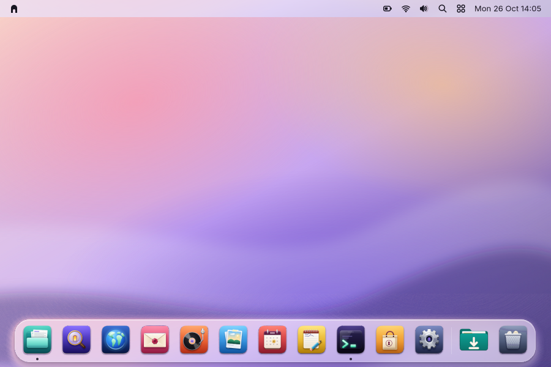
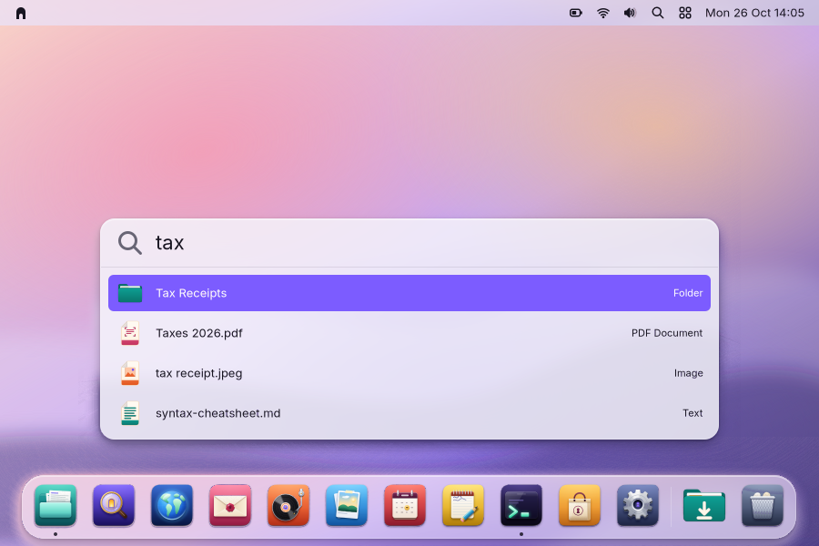

<h1 align="center">WolOS</h1>

<b>A calm, simple desktop. On the PC you already own.</b>

WolOS is an open source desktop operating system for ordinary PCs. It is built on Arch Linux packages, with a Rust system API, a GTK 4 shell (menu bar, Dock, Search, Control Center, Settings, Store, Setup Assistant), a window server built on a tuned fork of an open source Wayland compositor, and WolKernel, a Linux kernel tuned for foreground responsiveness and Steam/Proton games. Updates land in the other of two btrfs root slots (A/B, ADR 0016), so the old system is one reboot away.

> Active development. The image installs offline and boots; the full desktop is still being proven on real hardware. Expect rough edges.

 

The screenshots are made from the shell's golden images: `tools/site-shots.sh assets` (the site's `public/img` takes the same files).

## What is in this repo

| Path | What |
|---|---|
| `crates/` | Rust workspace: system API and daemons (`wold`, `wol-admind`, `wol-login`, `wol`), the GTK 4 shell (`crates/shell`), libwol, the app API behind a stable C ABI (`crates/wol-abi`), shared libraries |
| `wopkg/` | `wopkg`, the package tool for every source (ADR 0021), on `libwopkg` (`crates/wopkg`) |
| `kernel/` | `scx_wolos`, the WolOS sched_ext scheduler (userspace + BPF); the kernel itself is the fork below |
| `files/` | System files `wolos-system` installs: systemd units, installer, helpers |
| `desktop/`, `plugins/` | Desktop overlay and window server plugins |
| `docs/` | Architecture notes and decision records |
| `design/`, `assets/` | Brand and design art (see License) |

Related repositories:

- Recipes: https://github.com/wonderlandos/wolos-pkgbuilds (every package, the kernel too)
- Image: https://github.com/wonderlandos/wolos-iso (archiso profile, VM tests, release)
- Kernel fork: https://github.com/wonderlandos/linux (the WolKernel patches, one commit each, all public)
- Website source: https://github.com/wonderlandos/site (the manual, blog and packages API; deployed to Cloudflare Pages from `master`)

## Build

Develop: `cargo test --workspace`. Packages and the image are built from published sources, as in any
distribution: see [`BUILD.md`](BUILD.md) and ADR 0029.

See `kernel/README.md` for the kernel and `docs/` for how the pieces fit.

## Contributing

Issues and pull requests are welcome. Run `cargo test --workspace` before sending a change, keep changes focused, and say what you tested.

## License

Under [`COPYRIGHT`](COPYRIGHT): GPL-2.0-or-later for everything not listed below (`LICENSE`); libwol (`crates/wol-abi/`, `crates/shared/`, `crates/core/`) is BSD-2-Clause; `kernel/scx_wolos/` is GPL-2.0-only; `design/` and `assets/` are CC BY-NC-ND 4.0; `third_party/blocking/` is Apache-2.0 OR MIT. Each source file names its license in an `SPDX-License-Identifier` line. The WolOS name and logo are trademarks of Julia Klee; forks should use their own name and art.

Copyright (c) 2026 Julia Klee.
