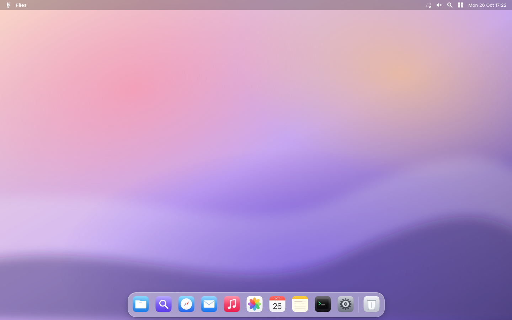
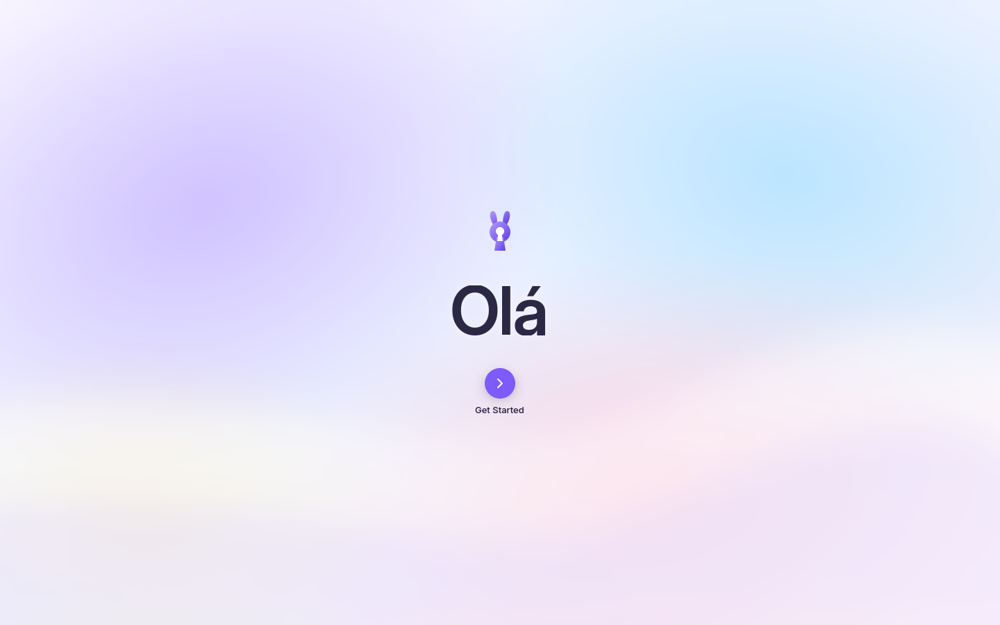
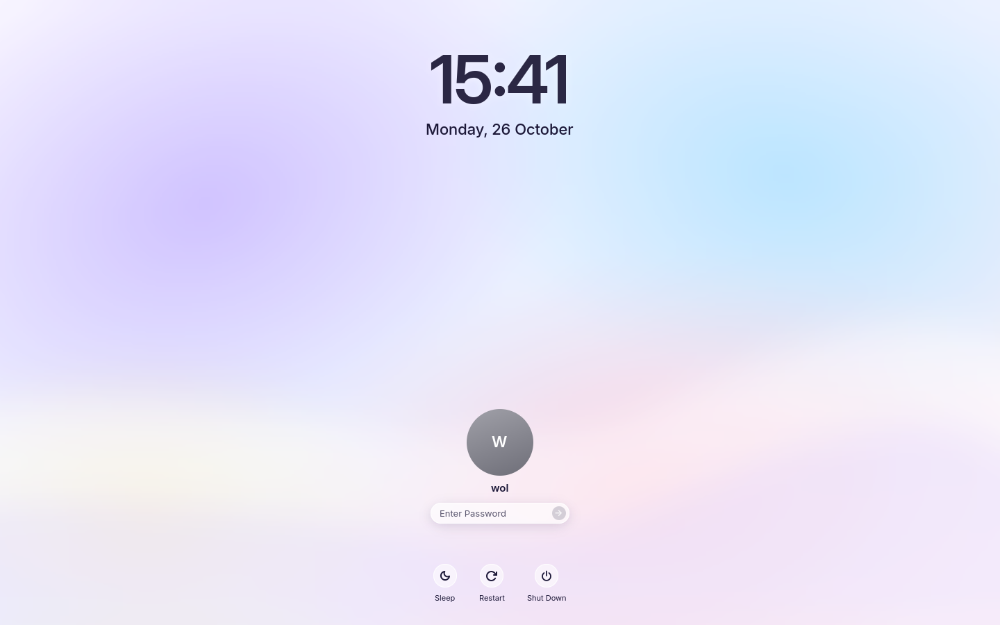
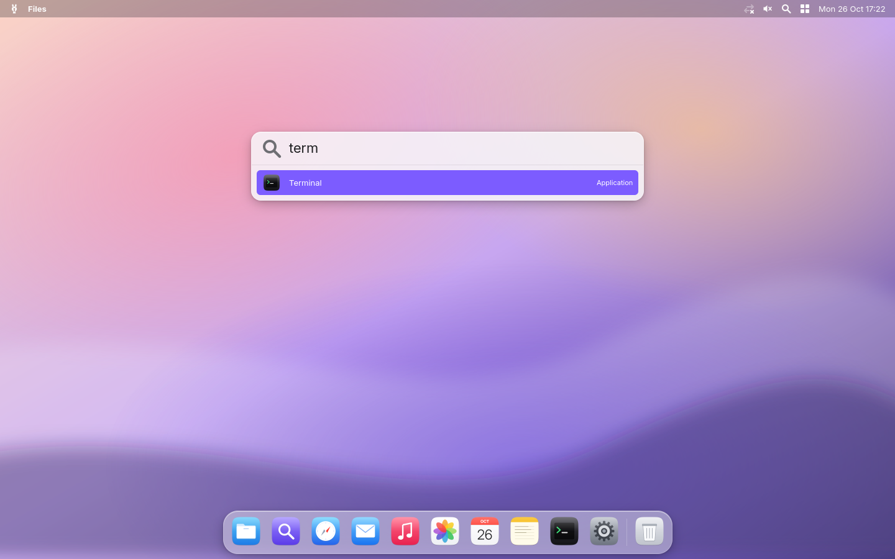
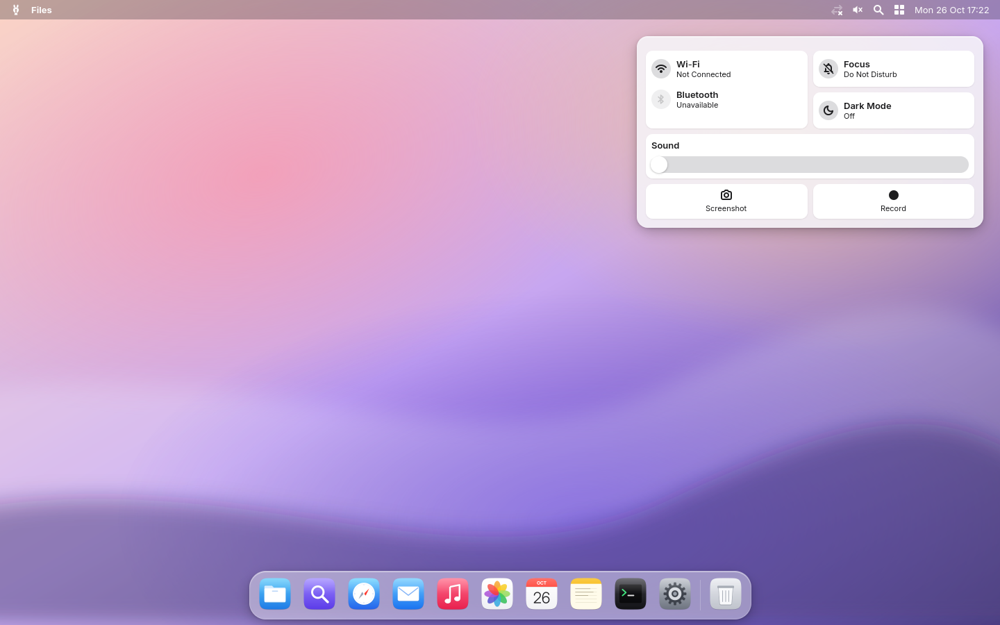
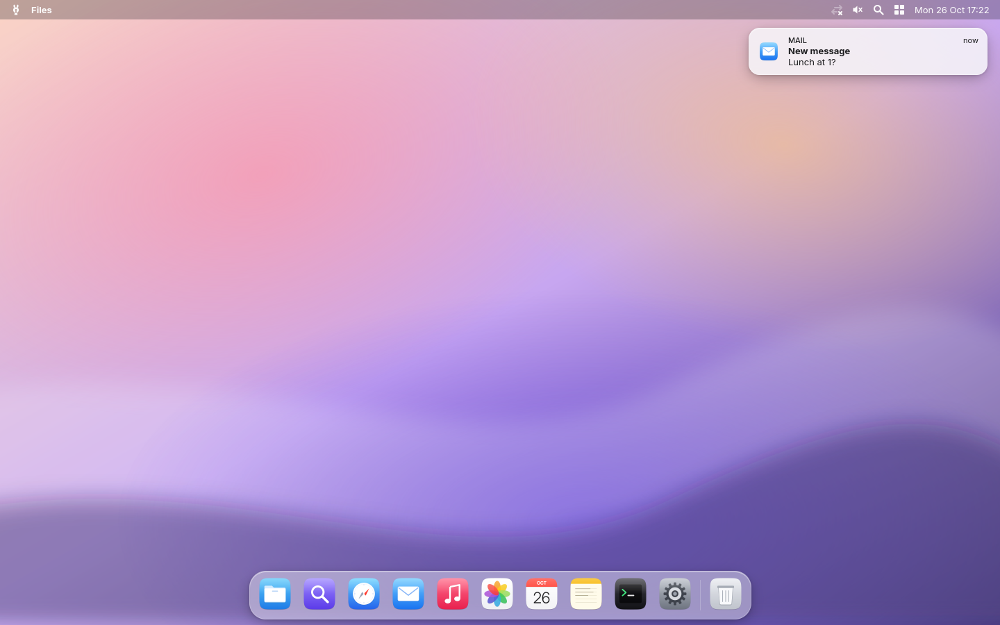
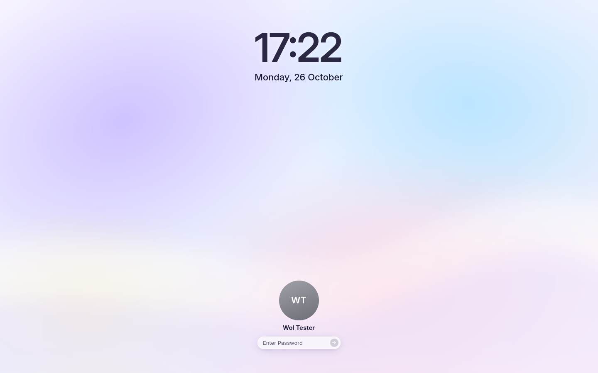
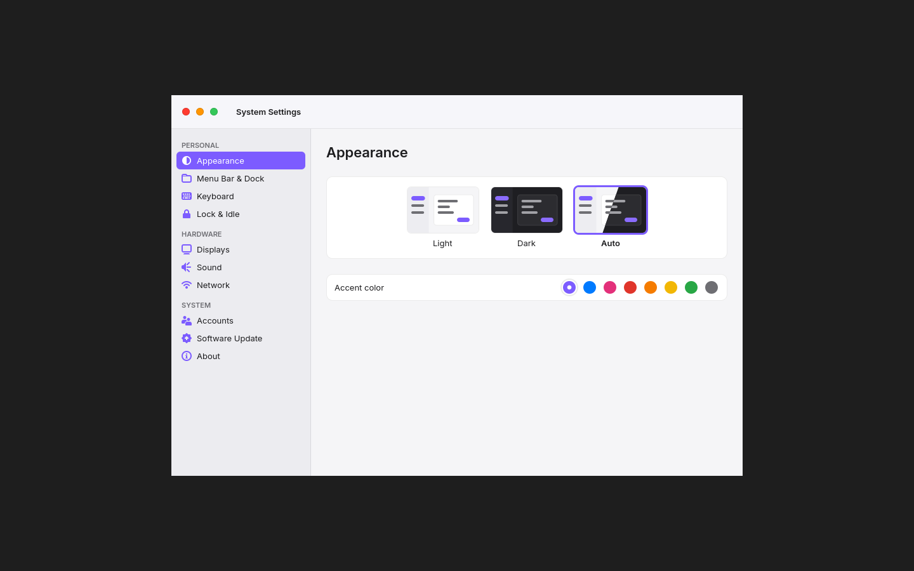
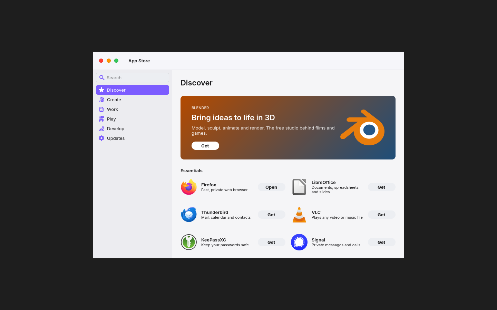

<h1 align="center">WolOS</h1>

<b>The Mac experience. On the PC you already own.</b>

Every PC deserves to feel like this. Calm. Fast. Obvious.
No terminal. No config files. No homework. You turn it on, and it works.

---

## Hello.

 

Boot the USB stick. Pick a disk. That's the installer — offline, one question, done.
Then a Setup Assistant greets you: language, Wi-Fi, your account, light or dark. A minute later you're home.

## Everything where your hands expect it.

 

**Spotlight** — `Super+Space`, type, Enter. Apps, files, settings.
**Control Center** — Wi-Fi, Bluetooth, Focus, Dark Mode, sound, screenshots. One click away.
**The Dock**, the **menu bar**, **notifications**, **traffic-light windows** that spring open. `Super` is `Cmd`. You already know how to use it.

 

## One place to change anything.

 

**System Settings** changes the real system — appearance, accent, displays, sound, network, accounts.
**App Store** installs Firefox, LibreOffice, Blender, VLC and more with one click. And your Firefox, LibreOffice and GTK/Qt apps all wear the same look.

## Every app just opens.

Native FreeBSD app? It runs. Linux app? It runs. Windows game? It runs.
WolOS picks the best build automatically — **native → Linux → Proton** — and our kernel speaks Linux's `futex_waitv`, the call Steam and Proton games live on.

## Fast. And it stays fast.

| | |
|---|---|
| Open Control Center, App Switcher, Mission Control | **~30 ms** to first frame |
| Spotlight, per keystroke | **0.6 ms** |
| Compositor at idle | **0.06 ms** of CPU per second |
| `futex_waitv` round trip | **0.19 µs** |

The app in front gets priority — from the window server straight into the kernel scheduler. The screen redraws only what changed, and sleeps when nothing moves.

## Updates that can't break your machine.

Every update lands in a new ZFS boot environment. If anything goes wrong, the old system is one reboot away.

---

## Under the hood

Built from the best of what already works, then tuned until it disappears.

| | |
|---|---|
| **Kernel** | FreeBSD 15.1 + WolOS patches: Linux `futex_waitv`, fast `sysret`, futex spin, QoS scheduling |
| **Window server** | Our Hyprland fork: per-frame animations, macOS window behaviour, `wol-hypr` plugin |
| **System** | One Rust system API: `wold`, `wol-admind`, `wol-login`, `wol` |
| **Shell** | Rust + GTK 4: menu bar, Dock, Spotlight, Control Center, Lock, Settings, App Store, Setup |

Every screenshot above is real WolOS on FreeBSD 15.1, rendered by the shipping code.

**Build:** `image/vm/build-in-vm.sh` → `image/vm/test-install.sh` · **Develop:** `cargo test --workspace` · **Architecture:** [`archicture/`](archicture/)

> Early. The image installs offline and boots; the full desktop is being proven on real hardware now.

**License:** BSD-2-Clause; the shell is GPL-3.0-or-later; brand art is CC BY-NC-ND 4.0 (share it to talk about WolOS; ask for anything else). See [`COPYRIGHT`](COPYRIGHT). © 2026 Julia Klee.
