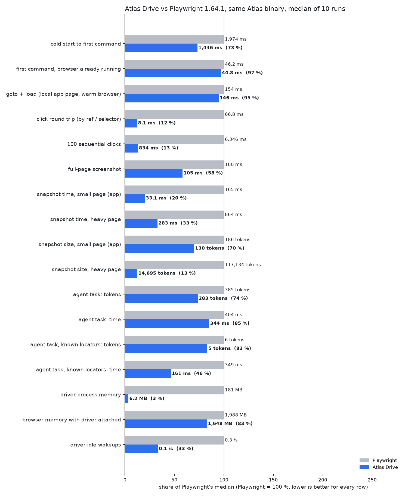
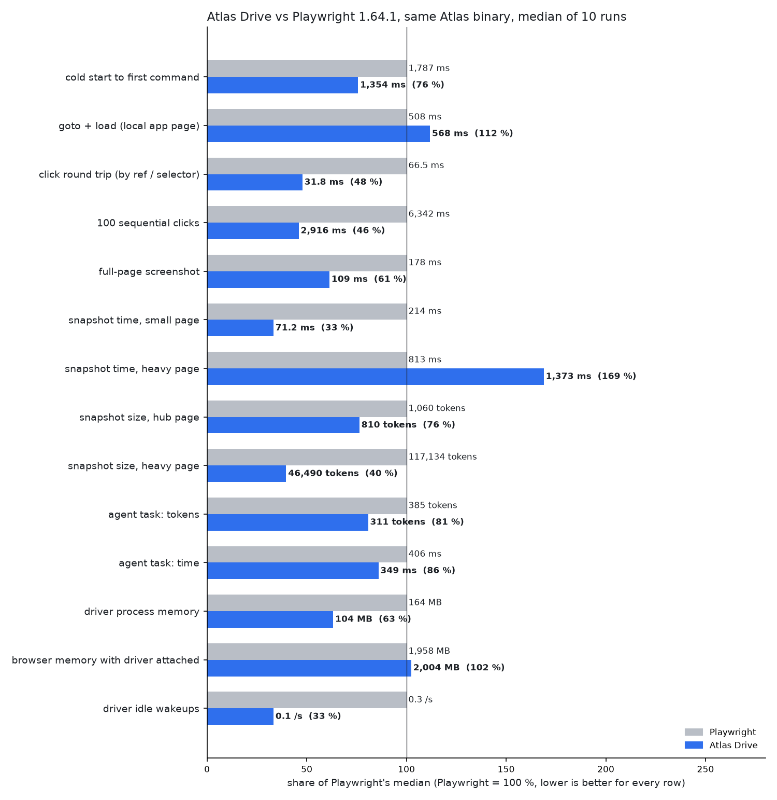

# Atlas Drive against Playwright (ADR 0063)

Two rounds on the same machine, the same Atlas binary and Playwright 1.64.1. Round 2 answers the lead's orders of 2026-11-05 05:12Z ("the snapshot strips the maximum of useless content for the model") and 05:40Z ("every metric under 500 ms and Drive beats Playwright on every row"). Round 1, below, is kept as it was measured.

## Round 2 (2026-11-05, runs 07:09Z to 07:19Z)

Raw runs: [atlas-drive-r2.json](atlas-drive-r2.json). Tool: `tools/bench/atlas-drive/` and `crates/atlas-drive/examples/bench.rs`, with the round-2 additions listed under "Method".



### Result in one paragraph

Drive wins all 17 chart rows: a click is 8x faster than Playwright's (8.1 against 66.8 ms) and 100 clicks take 0.83 s against 6.3 s; a snapshot of the 2300-link article takes 283 ms against 864 ms and is 14 695 tokens against 117 134 (8x fewer; round 1 was 46 490); a small page is 33 ms against 165 ms and 130 against 186 tokens; a script that knows its locators spends 5 tokens against 6 in less than half the time (161 against 349 ms); the browser is 17 % smaller with Drive attached (1648 against 1989 MB; in round 1 it was 2 % bigger) and the driver is 6.2 MB against 181 MB; the first command on a browser that already runs is 45 against 46 ms. **Not every row is under 500 ms, and four rows of the full table do not beat Playwright**: the cold start (1446 ms) and the page loads of this unoptimised component build (the first visit of a local page 592 ms, the article 735 ms, `fed://` 821 ms) are spent in the browser, measured below with a CDP client that is neither tool; on the first visit right after a cold start Drive is 9 % slower (592 against 540 ms) because its faster start leaves the browser less time to warm its first renderer; `fed://` loads are a tie (821 against 817 ms); the hub page's first load was aborted by the browser in 10 of 10 Drive runs and 4 of 10 Playwright runs (Drive retried and got the page in 3.5 s; a failed Playwright `goto` has no number, so its 300 ms is the median of the 6 loads that were not aborted); and on the wolos.org page Playwright's snapshot read 1060 tokens against Drive's 1412 because in most of its runs it read the page before the page finished rendering (its range is 1057 to 2679; Drive's is 1412 in every run). So the chart was not sent to #imagens.

### What changed since round 1, and what each change measured

| Change | Where | Measured effect |
|---|---|---|
| The accessibility tree an agent reads is built in the page, in Drive's isolated world, not asked of the browser's Accessibility domain | `src/mirror.rs`, `pagejs::SNAP` | heavy page: the walk itself 123 to 196 ms (12 walks in 3 logged passes of the measured binary, median 146) against `Accessibility.getFullAXTree` 820 to 990 ms on every call; snapshot verb 1373 -> 283 ms |
| Token diet: no address on named links (`--hrefs` shows them), no empty value or `unchecked`, no value beside a starred option, duplicate links and repeated labels dropped, runs of 10+ same-shaped controls folded to 6 (`--full` shows all) | `agent.rs` `fold`, line builder | heavy 46 490 -> 14 695 tokens, wolos.org 1737 -> 1412, hub 810 -> 755, app 167 -> 130, `fed://` home 89 -> 79, chrome://version 415 -> 423 (the in-page walk reads a little more text there than the browser's tree did) |
| `--quiet [--fields a,b]`: only the answer | `server.rs` `terse` | known-locator task 97 -> 5 tokens |
| `--disable-back-forward-cache` on the browser (Playwright passes it too) | `browser.rs` `browser_args` | only that flag changed, same sequence, single Drive runs: browser RSS 1984 -> 1649 MB, click 32.1 -> 7.7 ms, 100 clicks 3039 -> 784 ms, first command on a running browser 125 -> 43 ms; nine other Playwright flags (extensions, component update, background throttling) changed nothing measurable |
| A click where the pointer already is sends no move event | `verbs.rs` `click`, `mouse` | part of the click figures above |
| `goto` asks for no title (a title that is still the address is left out of the result); `retried` says when the browser aborted the first attempt | `verbs.rs` `goto`, `page.rs` `delta` | one round trip less per load |
| `serve --launch` starts the browser on a thread while the socket already answers | `main.rs` | pre-warmed daemon: first command 45 ms |
| `memory` switches the Performance domain off after reading it | `verbs.rs` `memory` | the domain no longer collects for the rest of the session |

The isolation the CTO asked for (the page must not see, detect or poison the walker) was checked live on the forge with a page that overrides `Element.prototype.getAttribute`, the `Node.prototype.textContent` getter and `Element.prototype.checkVisibility`, plants its own `window.__ad` pointing at a decoy button, and records DOM mutations: the snapshot still read `button "Real"` and `button "Decoy"`, the click on the ref of "Real" ran the real handler, the page's `__ad` was untouched and the only mutation the page saw was its own handler's (a live check with the daemon's socket, not a CI test: it needs the browser). A checkbox of opacity 0 under its label stays in the snapshot; text inside an element of opacity 0 is withheld and counted.

### Method (as round 1, plus)

- Same machine (the forge, shared by other builds: 1-minute load average 10 at the start of the runs and 19 at the end), same browser binary as round 1 (sha256 prefix edd41b166dab3967, the slot-4 component build with `fed://`), Playwright 1.64.1, Node v26.13.0, 10 runs per tool, interleaved, fresh browser and profile per run. Atlas Drive release build sha256 prefix 537e000a3c700faf, bench example 2bbb1b823f8ceaf0.
- **goto + load, warm browser** (new): after the page loop both tools idle 1 s and load `app.html?warm=1`. The first visits of the loop start right after the cold start, while the browser is still starting its first renderer; this row measures a load the driver can influence. The first-visit rows stay in the table.
- **first command, browser already running** (new): Drive: a new client of the running daemon sends `goto about:blank`; Playwright: `page.goto('about:blank')` on its running browser.
- **known locators**: Drive's batch now carries `quiet: true` (the answer only); Playwright's figure is the toast text plus 2 tokens for each of its two calls that answer nothing, as in round 1.
- **small page** rows use the app page (round 1 used the hub page, whose first load the browser aborts; see below).
- **aborted loads** are counted: `goto_retried` (Drive) and a failed `goto` (Playwright). Only the hub page had any.

### Table

| Metric | Playwright median [min-max] | Atlas Drive median [min-max] | Drive / Playwright |
|---|---|---|---|
| cold start to first command (ms) | 1974.2 [1597.1-2125] | 1445.6 [1193.2-1544.5] | 0.73 |
| first command, browser already running (ms) | 46.2 [42.7-61.6] | 44.8 [40.8-53.9] | 0.97 |
| goto + load (local app page, warm browser) (ms) | 153.8 [98.8-174.7] | 145.6 [93.1-189.3] | 0.95 |
| click round trip (by ref / selector) (ms) | 66.8 [48.9-69.2] | 8.1 [1.5-10.3] | 0.12 |
| 100 sequential clicks (ms) | 6346.3 [5159.2-6648.8] | 833.6 [250-872.7] | 0.13 |
| full-page screenshot (ms) | 180.2 [163.7-216.7] | 104.9 [86-129.9] | 0.58 |
| snapshot time, small page (app) (ms) | 164.6 [131.3-205.3] | 33.1 [29.2-38.2] | 0.20 |
| snapshot time, heavy page (ms) | 863.7 [716.2-967.6] | 283.2 [217.2-326.5] | 0.33 |
| snapshot size, small page (app) (tokens) | 186 [186-186] | 130 [130-130] | 0.70 |
| snapshot size, heavy page (tokens) | 117134 [117134-117134] | 14695 [14695-14695] | 0.13 |
| agent task: tokens (tokens) | 385 [385-385] | 283 [283-283] | 0.74 |
| agent task: time (ms) | 403.8 [336.1-439] | 343.7 [310.7-361.2] | 0.85 |
| agent task, known locators: tokens (tokens) | 6 [6-6] | 5 [5-5] | 0.83 |
| agent task, known locators: time (ms) | 348.6 [314.1-379.2] | 161.3 [140.7-180.3] | 0.46 |
| driver process memory (MB) | 180.8 [159.5-182.5] | 6.2 [6-30.8] | 0.03 |
| browser memory with driver attached (MB) | 1988.5 [1934-2002] | 1648 [1641-1653] | 0.83 |
| driver idle wakeups (/s) | 0.3 [0.2-0.7] | 0.1 [0.1-0.2] | 0.33 |
| click round trip by locator (ms) | 66.3 [50.7-67.4] | 15.8 [9.4-16.6] | 0.24 |
| goto + load: app (ms) | 540.5 [443.5-597] | 591.7 [479.5-658.4] | 1.09 |
| snapshot time: app (ms) | 164.6 [131.3-205.3] | 33.1 [29.2-38.2] | 0.20 |
| snapshot tokens: app (tokens) | 186 [186-186] | 130 [130-130] | 0.70 |
| snapshot time without the trap scan: app (ms) | 164.6 [131.3-205.3] | 8.5 [5.2-19.5] | 0.05 |
| goto + load: wolos (ms) | 3598.2 [424-4313.3] | 482.5 [365.4-575.6] | 0.13 |
| snapshot time: wolos (ms) | 230 [139.9-293.4] | 42.2 [27.7-64] | 0.18 |
| snapshot tokens: wolos (tokens) | 1060 [1057-2679] | 1412 [1412-1412] | 1.33 |
| snapshot time without the trap scan: wolos (ms) | 230 [139.9-293.4] | 16.9 [12.9-60.7] | 0.07 |
| goto + load: hub (ms) | 300 [194.2-343.9] | 3524.5 [2817.9-3820.8] | 11.75 |
| snapshot time: hub (ms) | 235.4 [184.5-270.6] | 26.9 [26.1-44.8] | 0.11 |
| snapshot tokens: hub (tokens) | 1060 [1060-1060] | 755 [755-755] | 0.71 |
| snapshot time without the trap scan: hub (ms) | 235.4 [184.5-270.6] | 12.1 [10.9-52.9] | 0.05 |
| goto + load: heavy (ms) | 811.3 [688-1129.4] | 735.3 [518.8-865.2] | 0.91 |
| snapshot time: heavy (ms) | 863.7 [716.2-967.6] | 283.2 [217.2-326.5] | 0.33 |
| snapshot tokens: heavy (tokens) | 117134 [117134-117134] | 14695 [14695-14695] | 0.13 |
| snapshot time without the trap scan: heavy (ms) | 863.7 [716.2-967.6] | 216.9 [196.8-245.9] | 0.25 |
| goto + load: fed (ms) | 817.3 [793.2-1043.3] | 821 [789.1-1045.5] | 1.00 |
| snapshot time: fed (ms) | 151.6 [120.1-171.1] | 30.1 [22.7-46.2] | 0.20 |
| snapshot tokens: fed (tokens) | 467 [467-467] | 79 [79-79] | 0.17 |
| snapshot time without the trap scan: fed (ms) | 151.6 [120.1-171.1] | 53.5 [38.6-72.9] | 0.35 |
| goto + load: chrome (ms) | 167.6 [124.9-206.4] | 167.4 [112.4-195.7] | 1.00 |
| snapshot time: chrome (ms) | 109.9 [79.6-151.4] | 26.4 [20.9-37.9] | 0.24 |
| snapshot tokens: chrome (tokens) | 786 [786-786] | 423 [423-423] | 0.54 |
| snapshot time without the trap scan: chrome (ms) | 109.9 [79.6-151.4] | 8.8 [6.1-12] | 0.08 |

### The rows over 500 ms or not won, and why

- **Cold start, 1446 ms (Playwright 1974).** Measured with a minimal CDP client over the same pipe (about 60 lines of Python, neither tool): the browser answers its first CDP command 0.9 to 1.1 s after it is started and loads its first `about:blank` 1.45 to 1.58 s after it is started, the same with a fresh profile and with a ready (copied) one. Drive's trace of the cold `goto about:blank`: navigate 15 ms, then 533 ms until the load event, the first renderer starting. Drive's own share is a process spawn and a socket connect. The way around it is not to be cold: `serve --launch` at session start, then the first command is 45 ms.
- **First visit of a page right after the cold start (app 592 ms against 540).** The same CDP client shows that the first local load ends 2.03 to 2.16 s after the browser starts whether it is asked for at once or 0.25 or 0.5 s later: the browser's spare renderer decides. Drive's cold start is 530 ms shorter, so its first load waits longer for that renderer; once the browser is warm the same load is 146 against 154 ms.
- **Page loads of 480 to 820 ms (wolos.org 482, the article 735, `fed://` 821).** The time is the component build loading and laying out the page (the article is 537 KB of HTML); both tools wait for the same `load` event and Drive wins two of the three. `fed://home.fed/` goes through the `atlas-fed` helper: 821 against 817 ms, ranges overlapping (789-1045 against 793-1043).
- **The hub page.** The first navigation to `127.0.0.1:8093` started within a second of the wolos.org page's load is cancelled by the browser about 2.8 s later with `net::ERR_ABORTED` and no response (the document request stays pending, then `Network.loadingFailed canceled`). The same happens with the minimal CDP client (once in 16 alternating loads of port 8091, and on the first load after an idle second), and the server answered `curl` in 2 ms (30 requests); with 3 s between the two loads it does not happen (Drive's CLI: 266 ms). It is the browser build or its fed/DNS layer, not a driver. Drive retries once and returns the page (`retried: true`, 3.5 s); Playwright's `goto` throws.
- **wolos.org snapshot tokens (Drive 1412, Playwright 1060).** The page renders in steps after its `load` event; Playwright's `ariaSnapshot` read 1057 to 2679 tokens depending on when it ran (2679 in the round-1 median and in the previous round-2 run), Drive read the rendered page every time.
- **Click by ref, 8.1 ms; 100 clicks, 0.83 s**: under the 20 ms and 2 s targets. A click by locator (15.9 ms) also walks the page to find the control.

### Not measured, not verified

- The PGO build of Atlas, headed mode, a GPU, other machines. The 500 ms targets were measured on a component build that is several times slower than the release build in the browser's own work.
- The in-page mirror against the browser's accessibility tree on pages outside this set (shadow DOM, iframes, ARIA widgets): the walk follows open shadow roots and slots and skips frames; `snapshot --ax` keeps the browser's tree for those.
- An incremental (dirty-subtree) mirror: not built.
- The isolation check is a manual live run, not a CI test.

### Reproduce (round 2)

```
cargo build -p atlas-drive --release --example bench
python3 tools/bench/atlas-drive/bench.py --runs 10 --browser BIN --drive target/release/atlas-drive \
    --bench target/release/examples/bench --pw DIR_WITH_pw.mjs_AND_node_modules --out atlas-drive-r2.json
python3 tools/bench/atlas-drive/chart.py atlas-drive-r2.json atlas-drive-r2.png tables.md
```
`ATLAS_DRIVE_TIMING=1` with `ATLAS_DRIVE_BENCH_LOG=FILE` logs every CDP round trip of the daemon; `ATLAS_DRIVE_BENCH_ARGS="--flag ..."` passes extra browser flags (how the back/forward cache was isolated).

## Round 1 (2026-11-05, before 05:20Z)

Raw runs: [atlas-drive.json](atlas-drive.json).

Lead order 2026-11-05 04:02Z: the Atlas driver "needs to be more fast, more enhanced, better for AI on tokens and contexts etc, so benchmark after". This page is that benchmark, with the numbers that lose as well as the ones that win. Raw runs: [atlas-drive.json](atlas-drive.json). Tool: `tools/bench/atlas-drive/` (`bench.py`, `pw.mjs`, `chart.py`) and `crates/atlas-drive/examples/bench.rs`.



### Result in one paragraph

Atlas Drive is faster than Playwright at what an agent does all day (a click 2.1x faster, 100 clicks 2.2x, a snapshot of a small page 2 to 5x and a tie on the wolos.org page, a full-page screenshot 1.6x, the first command after a cold start 1.3x, a script that knows its locators 2x), answers with fewer tokens (a heavy page 2.5x fewer, a small agent task 19 % fewer, the Federate home page 5x fewer), and its own process is smaller (104 MB against 164 MB) and quieter (0.1 against 0.3 wakeups a second). **It loses on a heavy page**: the browser needs about 1.1 s to hand over the whole accessibility tree of a 2300-link Wikipedia article, against 0.8 s for Playwright's in-page script (1.7x slower with the trap scan, 1.3x without it); page loads are a tie that the browser decides (Drive 1.0 to 1.12x); with locators written in advance Playwright spends far fewer tokens (6 against 97) because it returns nothing; and the browser itself is 2 % bigger while Drive is attached.

### What was measured

| | |
|---|---|
| Machine | the build forge (c6id.metal, 128 vCPU, shared: load average 21 to 70 from other builds during the runs, so absolute times are inflated and noisy; the two tools run interleaved, one after the other, so a slow minute hits both) |
| Browser | one binary for both tools: a reflink snapshot (2026-11-05 04:00Z) of the slot-4 component build of Atlas (unoptimised, with the `fed://` scheme and `atlas-fed` beside it), headless, `--no-sandbox --disable-gpu`, a fresh profile per run. Playwright gets it as `executablePath` |
| Playwright | 1.64.1 (`npm i playwright@latest`, no browser download), Node v26.13.0, `chromium.launch({executablePath, headless: true})` |
| Atlas Drive | this crate, release build (binary sha256 prefix 7bf198c73d31aa31; the later changes to text locators, per-site AUTO and the headed flag are not on the measured paths) |
| Runs | 10 per tool, interleaved, a new browser and a new daemon or Node process each time; the table gives the median and [min-max] |
| Tokens | bytes / 4 for both (the estimate every Drive result carries) |
| Flags | both start Atlas over the pipe. Playwright adds its own default flag set; Drive adds `--no-first-run --no-default-browser-check --password-store=basic --disable-background-networking --headless=new --hide-scrollbars` |

Pages (`PAGES` in `bench.py`):

| name | page |
|---|---|
| app | a local form page: nav, an Email field, a Plan select, a Save button that is disabled until the email is valid and shows a `status` toast 100 ms after a click, a Delete button that opens a `confirm`, a file input, a tall area and a button at the bottom |
| wolos | the local dist of wolos.org (`site/dist`, media left out), 148 lines in a Drive snapshot |
| hub | the static hub page of the same dist (see the note on this row) |
| heavy | the Wikipedia article "Atlas (mythology)" saved on 2026-11-05 with scripts, stylesheets, images and styles removed so the load is local and repeatable: 537 KB of HTML, 2317 links |
| fed | `fed://home.fed/` through the engine and `atlas-fed` |
| chrome | `chrome://version/`. Atlas's Kit chrome (toolbar, sidebar) is native views, not a page: no CDP client can see it, so this row stands for the browser's own WebUI pages |

Metrics, the same sequence in `examples/bench.rs` and `pw.mjs`:

- **cold start to first command**: from the start of the process (Drive: the daemon is spawned by the benchmark; Playwright: `process.uptime()` of Node, so module loading counts) to the first `goto about:blank` answered.
- **goto + load**: first visit of each page, wait for `load`.
- **snapshot**: Drive `snapshot` (default: trap scan on) against Playwright `locator('body').ariaSnapshot()`; also `snapshot` without the trap scan (the second snapshot of the same page, so a warm browser). Size is the text returned, in tokens.
- **click round trip**: median of 10 sequential clicks on the same button (Drive by ref, Playwright `page.click('#bottom')`, which includes its actionability checks) and by locator (`role=button name=...`, `getByRole`). **100 clicks**: the total.
- **full-page screenshot**: PNG of the app page written to a file.
- **agent task "find and press Save, read the toast"**, exploring (the agent does not know the page): Drive `snapshot --interactive-only`, then one `batch` of `fill` and `click --then diff` (the diff carries the toast); Playwright `ariaSnapshot()`, `fill`, `click`, wait for the status, `ariaSnapshot()` again. Tokens are what the agent reads: for Drive the `tokens` of the two results (counted on the JSON, which escapes quotes and newlines, so this is the pessimistic side), for Playwright the two snapshots plus 2 tokens for each call that answers nothing. **Known locators**: the script already knows what to press and read: Drive one `batch` of `fill`, `click`, `wait`, `eval`; Playwright `fill`, `click`, `innerText` of the status.
- **memory**: resident set of the driver process (the Drive daemon, the Node process) and of the whole browser tree, 1.5 s after the task. **Idle wakeups**: context switches of all threads of the driver over 10 idle seconds.

### Table

| Metric | Playwright median [min-max] | Atlas Drive median [min-max] | Drive / Playwright |
|---|---|---|---|
| cold start to first command (ms) | 1787.3 [1596.6-1922.1] | 1354 [1125.4-1472] | 0.76 |
| goto + load (local app page) (ms) | 507.7 [407.6-547.8] | 567.8 [465.5-642.4] | 1.12 |
| click round trip (by ref / selector) (ms) | 66.5 [63.1-67.3] | 31.8 [17.9-33.2] | 0.48 |
| 100 sequential clicks (ms) | 6341.5 [6046.5-6648.9] | 2916.3 [2499.5-3048.8] | 0.46 |
| full-page screenshot (ms) | 178 [154.9-210] | 109.3 [97.2-133.1] | 0.61 |
| snapshot time, small page (ms) | 213.7 [192.9-215] | 71.2 [61.1-95.4] | 0.33 |
| snapshot time, heavy page (ms) | 812.9 [753.5-860.7] | 1373 [1326.3-1466] | 1.69 |
| snapshot size, hub page (tokens) | 1060 [1057-1060] | 810 [810-810] | 0.76 |
| snapshot size, heavy page (tokens) | 117134 [117134-117134] | 46490 [46490-46490] | 0.40 |
| agent task: tokens (tokens) | 385 [385-385] | 311 [311-311] | 0.81 |
| agent task: time (ms) | 406.1 [387.7-439.9] | 349.1 [307.1-369.2] | 0.86 |
| driver process memory (MB) | 163.8 [160.5-184.3] | 103.7 [95.2-111.1] | 0.63 |
| browser memory with driver attached (MB) | 1957.5 [1925-1985] | 2004.5 [1999-2011] | 1.02 |
| driver idle wakeups (/s) | 0.3 [0.3-0.4] | 0.1 [0.1-0.2] | 0.33 |
| click round trip by locator (ms) | 66.7 [65.2-66.8] | 33.1 [32.5-33.7] | 0.50 |
| agent task with known locators: time (ms) | 334.9 [242.6-366.7] | 166.3 [142.7-187.4] | 0.50 |
| agent task with known locators: tokens (tokens) | 6 [6-6] | 97 [97-97] | 16.17 |
| goto + load: app (ms) | 507.7 [407.6-547.8] | 567.8 [465.5-642.4] | 1.12 |
| snapshot time: app (ms) | 165.8 [120.2-220.7] | 34 [23.3-56.6] | 0.21 |
| snapshot tokens: app (tokens) | 186 [186-186] | 167 [167-167] | 0.90 |
| snapshot time without the trap scan: app (ms) | 165.8 [120.2-220.7] | 15.1 [8.4-24.4] | 0.09 |
| goto + load: wolos (ms) | 516.6 [424.2-3950.2] | 491 [384.8-558.6] | 0.95 |
| snapshot time: wolos (ms) | 127.7 [95.6-240.4] | 130.5 [94.7-143] | 1.02 |
| snapshot tokens: wolos (tokens) | 2679 [1060-2679] | 1737 [609-1737] | 0.65 |
| snapshot time without the trap scan: wolos (ms) | 127.7 [95.6-240.4] | 80.9 [62.4-88.8] | 0.63 |
| goto + load: hub (ms) | 242.1 [216.9-3050.4] | 3074 [2646.3-3487.7] | 12.70 |
| snapshot time: hub (ms) | 213.7 [192.9-215] | 71.2 [61.1-95.4] | 0.33 |
| snapshot tokens: hub (tokens) | 1060 [1057-1060] | 810 [810-810] | 0.76 |
| snapshot time without the trap scan: hub (ms) | 213.7 [192.9-215] | 66.1 [52.1-75.6] | 0.31 |
| goto + load: heavy (ms) | 910.2 [650.4-1059.8] | 782.8 [620.7-868] | 0.86 |
| snapshot time: heavy (ms) | 812.9 [753.5-860.7] | 1373 [1326.3-1466] | 1.69 |
| snapshot tokens: heavy (tokens) | 117134 [117134-117134] | 46490 [46490-46490] | 0.40 |
| snapshot time without the trap scan: heavy (ms) | 812.9 [753.5-860.7] | 1089.6 [1014-1163.7] | 1.34 |
| goto + load: fed (ms) | 819 [805.5-1039.4] | 836.3 [804.6-1041.2] | 1.02 |
| snapshot time: fed (ms) | 152.1 [94.8-174.2] | 37.4 [31.8-112] | 0.25 |
| snapshot tokens: fed (tokens) | 467 [84-467] | 89 [89-285] | 0.19 |
| snapshot time without the trap scan: fed (ms) | 152.1 [94.8-174.2] | 62.4 [20.1-75.3] | 0.41 |
| goto + load: chrome (ms) | 160.3 [144.9-192.5] | 158.5 [147.3-186.3] | 0.99 |
| snapshot time: chrome (ms) | 108.2 [97.9-117] | 60.7 [49.2-64] | 0.56 |
| snapshot tokens: chrome (tokens) | 786 [786-786] | 415 [415-415] | 0.53 |
| snapshot time without the trap scan: chrome (ms) | 108.2 [97.9-117] | 27.5 [20.6-41.4] | 0.25 |

### How to read it, and what is not a win

- **Wins that hold on every page**: click and 100 clicks (the work is one pipelined `scrollIntoView`, `getContentQuads`, three mouse events and a focus probe; Playwright does its actionability protocol), snapshot of a page up to a few hundred nodes (one `getFullAXTree` against an injected script), cold start (no Node, no module load), driver memory, idle wakeups (the daemon blocks in `read`; nothing ticks), and the size of every snapshot (Drive prints one line per node a model can use, with relative links, merged text and withheld traps; `ariaSnapshot` prints the whole tree).
- **A tie**: `goto + load` (1.0 to 1.1x; the browser loads the page), `fed://` and `chrome://` loads.
- **A loss: heavy pages.** `Accessibility.getFullAXTree` costs the browser about 1.1 s on the 2300-link article (a 6.7 MB reply, parsed in 80 to 150 ms by the daemon); Playwright's `ariaSnapshot` runs inside the page in about 0.8 s. The trap scan adds about 0.3 s on the first snapshot of a page and is cached while the document does not change (`snapshot --safe=false` skips it). An incremental accessibility mirror (`Accessibility.enable` and the update events) would make every snapshot after the first nearly free; it is not built (ADR 0063, "Not decided").
- **A loss: tokens when the script already knows its locators.** Playwright's `fill` and `click` return nothing (6 tokens for the task); Drive's batch of four verbs returns 97 (and takes half the time: 166 against 335 ms). A Drive result could be made as small by asking for less (`budget`), but the default tells the agent what changed, which is the point when the locators are not known.
- **The agent task is a small win here** (311 against 385 tokens, 349 against 406 ms) because the test page is small: a full `ariaSnapshot` of it is 186 tokens. The advantage grows with the page: on the 2300-link article a snapshot is 46 490 tokens against 117 134, and `--interactive-only`, `--max-tokens` and `--diff` cut it further (not part of this table).
- **Browser memory** is 2 % higher with Drive attached: the accessibility tree built for `getFullAXTree` stays alive in the renderer.
- **The hub row.** Navigating to the hub page was cancelled by the browser (`net::ERR_ABORTED`) in 7 of 10 Playwright runs, on any origin, and Drive took about 3 s for it (the browser's delay, then one retry that succeeds). The cause was not found (no redirect or service worker in the page; the build is the FED-EXCLUSIVE slot with a DNS guard in front of the network service). The row is a property of this page and build, not of the driver; its Playwright statistics rest on the 3 runs that loaded. A Playwright `goto` that fails gives the agent nothing; Drive's retry gives the page.
- **`wolos` and `snapshot tokens: wolos`**: the Playwright range is bimodal (1060 or 2679 tokens) because that page changes while it loads; Drive's navigation collapse (a banner and a footer already shown on an earlier page of the tab are summarised) gives 609 or 1737.

### Not measured, not verified

- Headed mode, a real GPU, the official PGO build of Atlas (the component build is several times slower in the browser; the driver's own costs do not change), the page engine.
- The `fed://` page through the system `atlas-fed` package: the helper was the slot-4 binary.
- Playwright with its MCP server, with other launch flags, or `page.accessibility` (removed from Playwright); a Playwright run whose script uses `waitForLoadState('networkidle')`.
- The size of `page.content()` is in the raw JSON (`content_tokens`: 7461 on the hub page, 13 087 on wolos, 143 859 on the heavy page); it is what a script that reads HTML pays and is not part of the comparison.
- Memory of the browsers under Playwright's own default flags beyond the single figure in the table.

### Reproduce

```
cargo build -p atlas-drive --release --example bench
# pw.mjs needs Playwright: copy it to a directory where `PLAYWRIGHT_SKIP_BROWSER_DOWNLOAD=1 npm i playwright` was run
python3 tools/bench/atlas-drive/bench.py --runs 10 --browser BIN --drive target/release/atlas-drive \
    --bench target/release/examples/bench --pw DIR_WITH_pw.mjs_AND_node_modules --out results.json
python3 tools/bench/atlas-drive/chart.py results.json atlas-drive.png tables.md
```
The pages are served from `127.0.0.1:8091` (the test pages and the saved article), `:8092` (wolos.org dist) and `:8093` (the same dist, for the hub) with `python3 -m http.server`.
